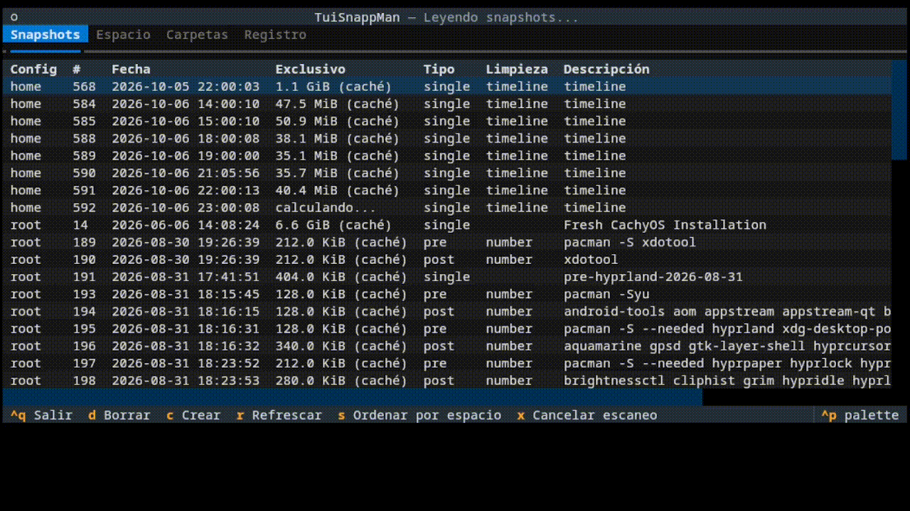

# TuiSnappMan

Interfaz de terminal (TUI) hecha con [Textual](https://textual.textualize.io/)
para gestionar snapshots de Snapper en btrfs.

En btrfs, borrar un archivo pesado no libera espacio si un snapshot anterior
todavía lo referencia. Pasa con juegos, ISOs, modelos de IA, cachés o builds
que se descargan y luego se borran. TuiSnappMan te muestra qué snapshots
retienen espacio, cuánto liberarías al borrar cada uno y te deja borrarlos o
crear un snapshot limpio sin memorizar comandos.

> Estado: v0.1, en desarrollo. Las pestañas **Carpetas** y **Registro** son
> placeholders.

## Demo



## Requisitos
- Linux con btrfs y Snapper configurado
- Python 3.11 o superior
- Permisos de root (`snapper` y `btrfs` los necesitan)

## Instalación
```bash
git clone https://github.com/jmono280/tuisnappman.git && cd TuiSnappMan
python -m venv .venv
source .venv/bin/activate
pip install -e ".[dev]"
```

## Uso
`sudo` no hereda el entorno virtual activado, así que usa la ruta del `venv`:
```bash
sudo .venv/bin/python -m tuisnappman
```
Prueba sin tocar nada con `--dry-run`: los comandos que modifican (borrar,
crear) se imprimen pero no se ejecutan.
```bash
.venv/bin/python -m tuisnappman --dry-run
```

| Tecla | Acción |
|---|---|
| `d` | Borrar el snapshot seleccionado (pide confirmación) |
| `c` | Crear un snapshot manual |
| `r` | Refrescar |
| `s` | Ordenar por espacio exclusivo |
| `x` | Cancelar el escaneo de espacio y quedarse con la caché |
| `Ctrl+Q` | Salir |

La columna **Exclusivo** es el espacio que se libera al borrar ese snapshot.

## Carga y tiempos

Al abrir, la tabla con todos los snapshots aparece al instante. Lo que tarda es
calcular la columna **Exclusivo**, el espacio que se liberaría al borrar cada
snapshot. Mientras se calcula, la cabecera muestra el progreso:

    Calculando espacio 12/60 (último: home #568) · x cancela

### Por qué tarda
Para medir el espacio de un snapshot, TuiSnappMan ejecuta:

    btrfs filesystem du -s --raw /home/.snapshots/<N>/snapshot

Ese comando recorre todos los archivos del snapshot. Es el mismo trabajo, y
tarda lo mismo, que si lo ejecutas a mano en la terminal: la aplicación no lo
hace más lento. La duración depende del número de archivos y de snapshots, así
que con cientos de GB y decenas de snapshots pueden ser varios minutos.

### Qué hace la app para que sea llevadero
- **Calcula 4 snapshots en paralelo** (`SIZE_WORKERS` en `app.py`).
- **Caché en disco.** Guarda cada tamaño calculado en
  `/var/cache/tuisnappman/sizes.json` (o `~/.cache/tuisnappman/` sin root). La
  próxima vez que abras la app verás los valores anteriores al instante, marcados
  como `12.1 GiB (caché)`, mientras se recalculan en segundo plano.
- **Cancelar con `x`.** Detiene el escaneo y mata los `btrfs` en curso. Se
  queda con lo que haya: valores en caché o `sin calcular`. Con `r` se reanuda.
- **`s` ordena por espacio** y se reordena solo a medida que llegan resultados.

Los valores en caché pueden estar desactualizados: al borrar un snapshot cambia
el espacio exclusivo de los demás. Por eso siempre se recalculan.

### Alternativa más rápida (no incluida)
Las quotas de btrfs dan estos tamaños al instante, pero tienen un costo de
rendimiento y requieren cambiar la configuración del sistema. TuiSnappMan no las
activa.

## Desarrollo
```bash
pytest                      # las pruebas nunca ejecutan snapper real
ruff check . && ruff format .
textual console             # en otra terminal, para depurar
textual run --dev src/tuisnappman/app.py
```

## Licencia
MIT
